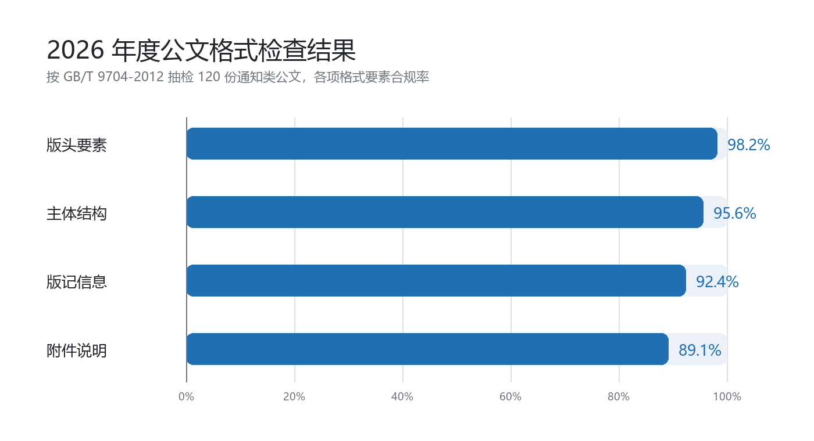

为进一步规范公文处理工作、提升公文质量，市政府办公室对 2026 年度报送的 120 份通知类公文进行了格式检查。现将有关情况通报如下。

# 检查范围

本次检查覆盖各区镇、市各委办局报送的正式公文。

# 检查结果

2026 年度公文格式检查总体情况见下图。

## 主要问题

- 版记信息：部分公文漏填印发机关或印发日期。
- 附件说明：附件名称与正文表述不一致，个别公文未标注附件顺序号。
- 主体结构：层次序数使用不规范，存在跳级现象。

## 整改要求

各单位要对照检查结果逐项整改，并于 2026 年 11 月 10 日前将整改情况报送市政府办公室。

# 工作要求

1. 建立问题台账，明确整改责任人和完成时限。
2. 组织公文格式专题培训，重点讲解 GB/T 9704-2012 的层次序数和版记要求。
3. 市政府办公室将于 11 月下旬组织抽查，检查结果纳入年度公文处理工作评价。
